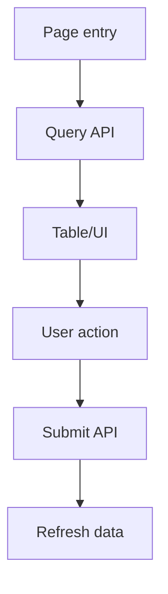

# Business Memory

Use this skill to read, create, and maintain durable business knowledge under `business_docs/`.

## Core Principle

`business_docs/` is a long-lived business memory, not a task tracker, commit log, or chat transcript.

Record only information that helps future AI sessions or developers understand business-critical behavior:

- business modules and their responsibilities
- key user/system flows
- business behavior changes
- API-to-UI relationships
- state transitions and business concepts
- known risks, pitfalls, and side effects
- relationship graphs and navigation indexes

Do not record generic coding style, temporary implementation plans, low-value investigation chatter, or source-code facts that are obvious from one local file.

## Directory Contract

Prefer this structure:

```text
business_docs/
├── navigation.md
├── README.md
├── changes/
├── modules/
├── flows/
├── graph/
└── templates/
```

Document types:

- `navigation.md`: entry point and index for future AI sessions.
- `changes/`: durable business behavior changes.
- `modules/`: long-lived business module knowledge.
- `flows/`: key business, user, or system flows.
- `graph/`: relationships between modules, flows, changes, APIs, states, and UI effects.
- `templates/`: optional project-owned Markdown templates.

If `business_docs/` or a subdirectory does not exist and the user asked to create/update business memory, create the minimal needed structure. Prefer updating existing related docs over creating duplicates.

## Progressive Loading Rules

Use progressive disclosure for both the skill and project docs:

1. Do not read every Markdown file under `business_docs/` by default.
2. For read/analysis tasks, start with `business_docs/navigation.md` when it exists.
3. Use `business_docs/README.md` only for onboarding or when the user asks how the system works.
4. Read only docs that match the requested page, module, button, flow, API, state, or change keyword.
5. If `navigation.md` is missing or incomplete, do a targeted filename/content search before reading files.
6. Read templates only when creating or updating docs.
7. After reading selected business docs, verify important claims against source code before presenting them as current truth.

## Workflow: Read Business Memory

Before analyzing a business feature or key flow:

1. Read `business_docs/navigation.md` if it exists.
2. Identify related module, flow, change, and graph docs from the user's request.
3. Read only the relevant business docs.
4. Summarize the known business context.
5. Inspect source code to verify important claims before treating them as current truth.
6. If docs are missing, stale, incomplete, or inconsistent with source code, say so explicitly.

## Workflow: Record Business Change

After business behavior changes:

1. Decide whether the change is worth recording.
2. Record only if it affects business logic, user-visible behavior, API semantics, state transitions, data interpretation, or key flows.
3. Search existing `business_docs/changes/`, `modules/`, and `flows/` for related docs.
4. Update existing docs first; create a new change doc only when no suitable doc exists.
5. Update related `modules/`, `flows/`, or `graph/` docs when the durable understanding changed.
6. Update `business_docs/navigation.md` so future readers can find the new or changed docs.

Use this structure for change records:

```md
# Change: {Title}

## 1. Change Type

Bugfix / Feature Enhancement / Refactor / Performance Optimization / API Change

## 2. Summary

## 3. Before

## 4. After

## 5. Impact Scope

- Modules:
- Flows:
- APIs:
- UI:
- State:
- Data:

## 6. Reason

## 7. Key Code Paths

## 8. Risk / Side Effects

## 9. Rollback Plan

## 10. Related Business Docs
```

## Workflow: Document Module

Use for long-lived business areas.

Include:

- purpose and business boundary
- entry points: route, page, component, store, API wrapper
- key files with one-line responsibilities
- business concepts, fields, states, and enums
- data flow from API/input to UI/output
- key user actions and corresponding code paths
- API dependencies and business meaning of important params/fields
- known risks, pitfalls, and confusing behavior
- related flows and changes

## Workflow: Document Flow

Use for key business or user journeys.

Include:

- trigger: user action, route entry, timer, callback, or system event
- entry point: file/component/function
- step-by-step flow
- key code paths
- API calls, params, response fields, and business meaning
- state changes
- UI effects
- error handling
- side effects: navigation, cache, persistence, analytics, dialogs, refreshes, global state
- related module/change/graph docs

## Workflow: Review Business Memory

When asked to review or clean `business_docs/`:

1. Check whether `navigation.md` exists and is useful.
2. Check whether important docs are reachable from navigation.
3. Check for duplicate, stale, or orphan docs.
4. Check whether change docs include before/after/impact/risk/rollback.
5. Check whether module docs include entry points, concepts, APIs, and related flows.
6. Check whether flow docs include code paths, APIs, state changes, UI effects, error handling, and side effects.
7. Recommend cleanup without modifying files unless the user asked you to modify them.

## Update Decision

Update `business_docs/` when:

- business logic changes
- user-visible behavior changes
- API semantics, request params, response interpretation, or API usage changes
- important state transitions or business statuses change
- a new business module or key flow is discovered
- a bugfix reveals durable business knowledge or a recurring pitfall
- a relationship between modules, flows, APIs, or UI behavior becomes important for future maintenance

Usually skip updates for:

- formatting only
- local variable rename only
- small style-only changes
- generic technical refactors without behavior change
- temporary investigation notes
- source-code details that are obvious and unlikely to help future business debugging

## Navigation Rules

Maintain `business_docs/navigation.md` as the primary entry point. Keep entries short and useful:

```md
# Business Docs Navigation

## Modules

- [Module name](modules/module_xxx.md) — what this module covers

## Key Flows

- [Flow name](flows/flow_xxx.md) — what this flow explains

## Changes

- [YYYY-MM-DD Change title](changes/change_YYYY-MM-DD_xxx.md) — one-line summary

## Graph

- [Business relationships](graph/relationships.md)
```

Update navigation whenever creating a new module, flow, change, or important graph doc.

## Graph Rules

Use simple Markdown plus Mermaid when relationship diagrams help future readers.

Prefer lightweight relationships over exhaustive diagrams. Example document shape:

````md
# Business Relationship Graph



## Relationships

- `module_xxx` contains `flow_xxx_query`
- `flow_xxx_submit` affects `module_xxx`
- `change_YYYY-MM-DD_xxx` modifies `flow_xxx_submit`
````

## Output Requirements

When using this skill, report:

- business docs read
- business docs created or updated
- whether `business_docs/navigation.md` was updated
- source files verified for important claims
- missing, stale, or incomplete business memory found

If only analyzing and not modifying docs, say that no `business_docs/` files were changed.
